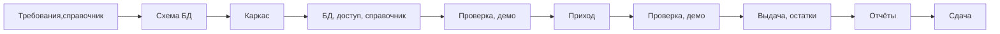

```mermaid
flowchart TD
    A["Учёт товаров на складе"]
    A --> B["1.0 Анализ и проектирование"]
    A --> C["2.0 Инкремент 1: справочник и доступ"]
    A --> D["3.0 Инкремент 2: поступление"]
    A --> E["4.0 Инкремент 3: выдача и остатки"]
    A --> F["5.0 Инкремент 4: отчёты и права"]
    A --> G["6.0 Внедрение и сдача"]

    B --> B1["1.1 Обследование склада"]
    B --> B2["1.2 Требования и справочник"]
    B --> B3["1.3 Схема БД и архитектура"]
    B --> B4["1.4 Эскизы экранов, тест-план"]

    C --> C1["2.1 Очистка номенклатуры"]
    C --> C2["2.2 БД, авторизация, роли"]
    C --> C3["2.3 Справочник и поиск"]
    C --> C4["2.4 Импорт из Excel"]

    D --> D1["3.1 Логика прихода и пересчёт остатка"]
    D --> D2["3.2 Форма прихода и журнал"]
    D --> D3["3.3 Проверка расчёта и регрессия"]

    E --> E1["4.1 Логика выдачи и контроль остатка"]
    E --> E2["4.2 Экран остатков и история"]
    E --> E3["4.3 Сверка с фактом по выборке"]

    F --> F1["5.1 Отчёты"]
    F --> F2["5.2 Права трёх ролей"]
    F --> F3["5.3 Обучение кладовщиков"]

    G --> G1["6.1 Инвентаризация и перенос остатков"]
    G --> G2["6.2 Развёртывание"]
    G --> G3["6.3 Приёмочные испытания и сдача"]
```

|Задача|Трудоёмкость|
|---|---|
|Анализ и проектирование|54 ч|
|Инкремент 1: справочник и доступ|49 ч|
|Инкремент 2: поступление|45 ч|
|Инкремент 3: выдача и остатки|50 ч|
|Инкремент 4: отчёты и права|32 ч|
|Внедрение и сдача|36 ч|

Всего: 278 человеко-часов

|Роль|Ответственность|
|---|---|
|Руководитель проекта| План работ, сроки, распределение задач, коммуникация с заказчиком, документация проекта |
|Аналитик| Обследование склада, сбор и фиксация требований, согласование справочника товаров |
|Разработчик| Структура базы данных, серверная логика, расчёт остатков, интерфейс |
|Тестировщик| Поиск ошибок, проверка загрузки данных, расчёта остатков и прав доступа |

|Этап|1|2|3|4|5|6|7|8|9|10|11|
|---|---|---|---|---|---|---|---|---|---|---|---|
|Анализ и проектирование          |X|X|X| | | | | | | | |
|Инкремент 1: справочник и доступ | | | |X|X| | | | | | |
|Инкремент 2: поступление         | | | | | |X|X| | | | |
|Инкремент 3: выдача и остатки    | | | | | | | |X|X| | |
|Инкремент 4: отчёты и права      | | | | | | | | | |X| |
|Внедрение и сдача                | | | | | | | | | | |X|