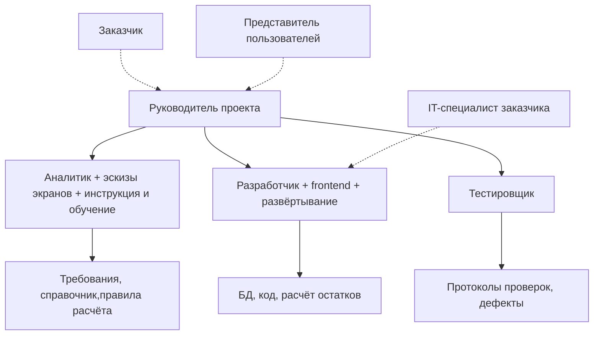

|Роль|Совмещаемые роли|Доступное время в неделю|за 11 недель|Запланированная работа|Загрузка|
|---|---|
|Руководитель проекта|документация|4 ч|44 ч|34 ч|77 %|
|Аналитик|UI/UX-дизайнер (эскизы), обучение пользователей|8 ч|88 ч| 60 ч|68 %|
|Backend-разработчик|Frontend, первичная проверка своего кода|14 ч|154 ч| 122 ч|79 %|
|Тестировщик|Приёмочные сценарии совместно с аналитиком|8 ч|88 ч| 62 ч|70 %|

|Роль|Отвечает за результат|Решает самостоятельно|Согласует с руководителем проекта|
|---|---|---|---|
|Руководитель проекта|Календарный план, сроки контрольных точек, распределение задач, отчётность перед заказчиком|Перераспределение задач внутри инкремента, порядок и состав рабочих встреч| |
|Аналитик|Полнота и непротиворечивость требований, состав справочника, эскизы, обучение|структура эскизов, состав справочника (по согласованию с кладовщиком)|любое новое требование, влияющее на объём или срок, перенос обучения|
|Разработчик|Работающий код, схема БД, корректность расчёта остатка, развёртывание приложения|структура кода, библиотеки, способ реализации функции, порядок задач внутри инкремента|смена стека или СУБД, изменение схемы БД после КТ2, перенос задачи за пределы инкремента|
|Тестировщик|Достоверность проверки, протоколы испытаний, полнота регрессии, учёт дефектов|Состав тест-кейсов, регистрация и приоритизация дефектов|перенос сроков проверки, привлечение кладовщиков к тестированию|

