## Задание 1. Создание WBS

```mermaid
flowchart TD
    A["Система управления задачами"]
    A --> B["1.0 Анализ и проектирование"]
    A --> C["2.0 Backend"]
    A --> D["3.0 Frontend"]
    A --> E["4.0 Тестирование"]
    A --> F["5.0 Внедрение"]

    B --> B1["1.1 Анализ требований"]
    B --> B2["1.2 Роли и права доступа"]
    B --> B3["1.3 Проектирование БД"]
    B --> B4["1.4 Макеты интерфейса"]
    B --> B5["1.5 Контракты API"]

    C --> C1["2.1 Создание структуры БД"]
    C --> C2["2.2 Регистрация"]
    C --> C3["2.3 Авторизация"]
    C --> C4["2.4 API создания и редактирования задач"]
    C --> C5["2.5 API исполнителей и статусов"]
    C --> C6["2.6 API списка и поиска задач"]

    D --> D1["3.1 Формы регистрации и входа"]
    D --> D2["3.2 Экран списка задач"]
    D --> D3["3.3 Форма создания/редактирования"]
    D --> D4["3.4 Выбор исполнителя и статуса"]
    D --> D5["3.5 Поиск и фильтры"]
    D --> D6["3.6 Интеграция с API"]

    E --> E1["4.1 Проверка регистрации и входа"]
    E --> E2["4.2 Проверка работы с задачами"]
    E --> E3["4.3 Проверка исполнителей и статусов"]
    E --> E4["4.4 Проверка поиска и списка"]
    E --> E5["4.5 Проверка прав доступа"]
    E --> E6["4.6 Исправление ошибок и регресс"]

    F --> F1["5.1 Настройка сервера"]
    F --> F2["5.2 Развёртывание"]
    F --> F3["5.3 Инструкция и передача заказчику"]
```

## Задание 2. Определение контрольных точек
|Контрольная точка|Критерий достижения|
|---|---|
|Требования и макеты утверждены|Заказчик согласовал список функций и экраны|
|База данных готова|Таблицы и связи созданы |
|Пользователь может войти в систему|регистрация и вход проходят через интерфейс|
|Готов первый рабочий прототип|Задачу можно создать, отредактировать, назначить исполнителя, сменить статус|
|Тестирование завершено|Все основные сценарии проверены, критических дефектов нет|
|Продукт передан заказчику|Система развёрнута, доступна пользователям, есть инструкция|

## Задание 3. Определение зависимостей
|Задача|Не может начаться до|Причина|
|---|---|---|
|1.3 Проектирование БД|1.1, 1.2|Нужно знать сущности и права, чтобы задать поля и связи|
|1.4 Макеты интерфейса|1.1|Экраны рисуются под утверждённые сценарии|
|1.5 Контракты API|1.1, 1.3|Формат данных зависит от модели БД|
|2.1 Создание БД|1.3|Нельзя создать таблицы без утверждённой схемы|
|2.2 Регистрация|2.1|Некуда сохранять пользователя|
|2.3 Авторизация|2.2|Проверять нечего, пока нет пользователей|
|2.4 API задач|2.1, 2.3|Нужны таблица задач и проверка доступа|
|2.5 Исполнители и статусы|2.4|Назначать исполнителя можно только существующей задаче|
|2.6 Список и поиск|2.4|Нужны данные и структура задачи|
|3.1-3.3 Экраны|1.4, 1.5|Работа идёт по макетам и контрактам, не дожидаясь Backend|
|3.4 Исполнитель и статус|3.3|Элементы размещаются в карточке задачи|
|3.5 Поиск и фильтры|3.2|Фильтруется уже существующий список|
|3.6 Интеграция|2.2-2.6, 3.1-3.5|Нужны обе готовые части|
|4.1-4.5 Тестирование сценариев|3.6|Сквозной сценарий проверяется только в собранной системе|
|4.6 Исправление и регресс|4.1-4.5|Сначала нужен список найденных дефектов|
|5.2 Развёртывание|4.6, 5.1|Нельзя выкладывать непротестированную версию на готовое окружение|
|5.3 Передача заказчику|5.2|Показывать можно только работающую систему|